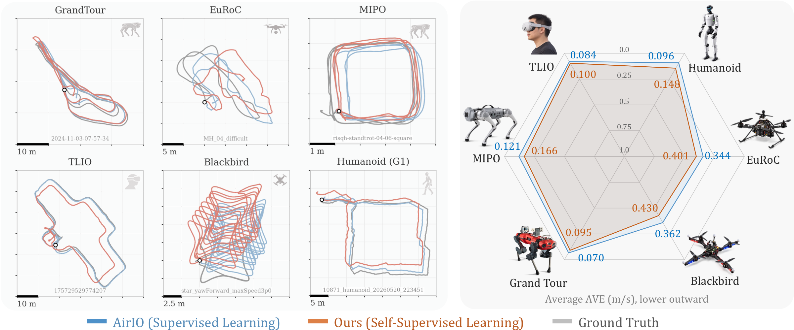

<p align="center">
  
</p>

# <div align="center">SSIO: Self-Supervised Inertial Odometry</div>

<p align="center">
  <a href="https://ssio-imu.github.io"></a>
  <a href="https://arxiv.org/abs/2610.25988"></a>
  <a href="https://huggingface.co/collections/Open-IO/ssio-self-supervised-inertial-odometry"></a>
  
  
  <a href="LICENSE"></a>
</p>

<p align="center">
  
</p>

<p align="center"><em>
SSIO trains inertial odometry from a robot's own unlabeled IMU stream, with no velocity
or position labels. Trained from scratch on each of six embodiments (pedestrians, drones,
quadrupeds, and a humanoid), SSIO (orange) is comparable to the supervised AirIO
baseline (blue). A new embodiment needs only a calibrated IMU and recordings from normal
operation.
</em></p>

## 🔥 Updates

* [Oct 2026] Initial code release: integration self-supervision, pose graph
  distillation, evaluation, and loaders for all six datasets in the paper.

## 💡 Method Overview

SSIO trains in two steps, named as in the paper:

```
unlabeled IMU ──► 1. Integration Self-Supervision ──► 2. Pose Graph Distillation (optional)
                     train_ssio.py → "Ours"              train_pgd.py → "Ours (w/ PGD)"
```

1. **Integration Self-Supervision** (`train_ssio.py`): the network learns body-frame
   velocity from an IMU integration teacher on short unlabeled windows, with optional
   **Stationary Regularization** on detected stops.
2. **Pose Graph Distillation** (`train_pgd.py`, optional): a pose graph over each training
   sequence turns the network's predictions into sequence-consistent velocity targets,
   and the network is fine-tuned on them.

## 🔧 Minimum Requirements

| Component   | Requirement | Notes |
|-------------|-------------|-------|
| **Python**  | ≥ 3.10      | |
| **PyTorch** | < 2.14      | 2.14 breaks PyPose preintegration; tested with 2.5.1 |
| **CUDA**    | Optional    | Only for `graph=sparse_imupgo` (Linux, cuDSS); a GPU is recommended for full-scale training |

## 📦 Installation & Environment

1. **Create an environment**

    ```bash
    conda create -n ssio python=3.10
    conda activate ssio
    ```

2. **Install the remaining dependencies**

    ```bash
    pip install -r requirements.txt
    ```

### Datasets

Datasets are read from `$DATA_ROOT`; outputs go to `$EXP_DIR` (default: `./experiments`).

```bash
export DATA_ROOT=/path/to/datasets
```

| Dataset   | Platform                      | Duration | Download | Path under `$DATA_ROOT` |
|-----------|-------------------------------|----------|----------|-------------------------|
| TLIO      | Pedestrian, head-mounted      | 31.6 h   | **[TLIO](https://github.com/CathIAS/TLIO)** | `TLIO/` |
| EuRoC     | Micro aerial vehicle          | 22.5 min | **[ETH ASL](https://projects.asl.ethz.ch/datasets/euroc-mav)** | `EuRoC/<seq>/mav0/` |
| Blackbird | Racing drone                  | 5.0 h    | **[Blackbird](https://github.com/mit-aera/Blackbird-Dataset)** | `BlackBird/` |
| MIPO      | Unitree Go1 quadruped, 5 IMUs | 58.6 min | **[🤗 Open-IO/mipo-go1-odometry](https://huggingface.co/datasets/Open-IO/mipo-go1-odometry)** | `mipo_hdf5/indoor/` |
| GrandTour | ANYmal quadruped, outdoor     | 5.65 h   | **[GrandTour](https://grand-tour.leggedrobotics.com)** | `grand_tour/` |
| Humanoid  | Unitree G1 humanoid           | 1.17 h   | **[🤗 humanoid-g1-odometry](https://huggingface.co/datasets/Open-IO/humanoid-g1-odometry)** | `humanoid_g1/` |

The Humanoid dataset is released with this work on Hugging Face, and so is MIPO,
converted from the [Cerberus 2.0](https://github.com/ShuoYangRobotics/Cerberus2.0)
rosbags. Download them into the paths the configs read:

```bash
hf download Open-IO/humanoid-g1-odometry --repo-type dataset \
    --local-dir $DATA_ROOT/humanoid_g1
hf download Open-IO/mipo-go1-odometry --repo-type dataset \
    --local-dir $DATA_ROOT/mipo_hdf5
```

The train, validation, and test splits in `Config/dataset/` match the
[Hugging Face checkpoints](https://huggingface.co/collections/Open-IO/ssio-self-supervised-inertial-odometry).

* **GrandTour** configs read per-IMU IMU-to-GT time offsets from
  `$DATA_ROOT/grand_tour/anymal_imu_gt_offsets_per_imu.json`, our calibration (not part of
  the GrandTour release) and the one the GrandTour checkpoints were trained with. Download it:

  ```bash
  hf download Open-IO/SSIO calibration/grand_tour/anymal_imu_gt_offsets_per_imu.json --local-dir /tmp/ssio
  cp /tmp/ssio/calibration/grand_tour/anymal_imu_gt_offsets_per_imu.json $DATA_ROOT/grand_tour/
  ```

  or regenerate it with
  `python Scripts/measure_anymal_imu_gt_offsets_per_imu.py --data-root $DATA_ROOT/grand_tour --out-json $DATA_ROOT/grand_tour/anymal_imu_gt_offsets_per_imu.json`.

* **MIPO** is read from per-trial HDF5 files plus the `mipo_time_offsets.json`
  calibration file, both in the Hugging Face dataset (format:
  [`Doc/mipo_hdf5_format.md`](Doc/mipo_hdf5_format.md)). The rosbag-to-HDF5 converter
  is not included in this repository.

## 🚀 Quick Start: Run SSIO on the EuRoC Sample

The repository ships a 10 s slice of EuRoC `MH_02_easy` under `tests/fixtures/`. Run the
three steps below from the repository root.


### 1/3 Integration Self-Supervision

```bash
python train_ssio.py network=airio_imu_only \
    'hydra.searchpath=[file://tests/fixtures/config]' \
    dataset@train_dataset=EuRoC_Smoke_Train dataset@eval_dataset=EuRoC_Smoke_Valid \
    train.epoch=1 train.batch=4 train.max_train_steps=2 train.dv_imu_input=raw \
    'meta.device=${as_device:cpu}' wandb.mode=disabled \
    hydra.run.dir=./experiments/quickstart/ssio
```

### 2/3 Pose Graph Distillation

```bash
python train_pgd.py network=airio_imu_only graph=dense_imupgo \
    'hydra.searchpath=[file://tests/fixtures/config]' \
    dataset@train_dataset=EuRoC_Smoke_Train dataset@eval_dataset=EuRoC_Smoke_Valid \
    train.epoch=1 train.batch=4 train.max_train_steps=2 train.dv_imu_input=raw \
    train.network_factor_sigma=1.0 \
    train.resume_from=file:./experiments/quickstart/ssio/checkpoint_00002.pt \
    'meta.device=${as_device:cpu}' wandb.mode=disabled \
    hydra.run.dir=./experiments/quickstart/pgd
```

### 3/3 Evaluate

```bash
python evaluate.py ./experiments/quickstart/pgd
```

Metrics and plots are written to `experiments/quickstart/pgd/eval/checkpoint_00001/`:
`result.json` (per sequence), `summary.json` (aggregate), and trajectory, velocity,
translation, and rotation plots for each sequence.

## 🛠️ Reproducing the Paper

`Config/experiment/<dataset>/` holds one recipe per paper experiment, with the
hyperparameters of the matching Hugging Face checkpoint. `<dataset>` is one of `tlio`,
`euroc`, `blackbird`, `mipo`, `grandtour`, or `humanoid`. [`Doc/recipes.md`](Doc/recipes.md)
lists every recipe with its command, Hugging Face run, and paper and checkpoint scores.

| Recipe | Paper row | Entry point |
|---|---|---|
| `airio` | AirIO† (supervised); add `network=airio` for AirIO | `train_ssio.py` |
| `ssio` | Ours | `train_ssio.py` |
| `ssio_pgd` | Ours (w/ PGD) | `train_pgd.py` |
| `airio_proprio`, `ssio_proprio` | AirIO† + *Proprio*, Ours + *Proprio* (MIPO, GrandTour, Humanoid) | `train_ssio.py` |

```bash
python train_ssio.py +experiment=euroc/ssio
python train_pgd.py +experiment=euroc/ssio_pgd train.resume_from=file:<SSIO_RUN>/best_model.pt
python evaluate.py <RUN_DIR> --checkpoint best_model.pt --data Config/dataset/EuRoC_Test.yaml
```

Each run writes a directory under `$EXP_DIR` with `.hydra/config.yaml`, checkpoints, and
`best_model.pt`; `<SSIO_RUN>` and `<RUN_DIR>` refer to it. Each recipe's header names its
Hugging Face run and that run's test AVE / ATE. Command-line overrides still take
precedence, e.g. `+experiment=euroc/airio network=airio`.

> [!NOTE]
>
> The released "Ours (w/ PGD)" checkpoints do not match the paper's PGD row exactly; see
> [`Doc/recipes.md`](Doc/recipes.md) for both numbers.

To train without a recipe, or to change the method, see [`Doc/training.md`](Doc/training.md).

## 🤗 Pretrained Checkpoints

Every model in the paper's tables is on Hugging Face in
[`Open-IO/SSIO`](https://huggingface.co/Open-IO/SSIO), one run directory per cell
(`best_model.pt` plus the training run's `.hydra/` config). AirIO and AirIO† are the
supervised baselines; the other columns are self-supervised.

| Dataset | AirIO | AirIO† | Ours | Ours (w/ PGD) | AirIO† + *Proprio* | Ours + *Proprio* |
|---|---|---|---|---|---|---|
| TLIO | [q1k41m3r](https://huggingface.co/Open-IO/SSIO/tree/main/supervised/q1k41m3r) | [8pr646j5](https://huggingface.co/Open-IO/SSIO/tree/main/supervised/8pr646j5) | [ev7hukzs](https://huggingface.co/Open-IO/SSIO/tree/main/stage1/ev7hukzs) | [udfvlewc](https://huggingface.co/Open-IO/SSIO/tree/main/stage2b/udfvlewc) | – | – |
| EuRoC | [n50vs978](https://huggingface.co/Open-IO/SSIO/tree/main/supervised/n50vs978) | [ncntl12t](https://huggingface.co/Open-IO/SSIO/tree/main/supervised/ncntl12t) | [189uubgg](https://huggingface.co/Open-IO/SSIO/tree/main/stage1/189uubgg) | [u0ej57z3](https://huggingface.co/Open-IO/SSIO/tree/main/stage2b/u0ej57z3) | – | – |
| Blackbird | [4ktbuoar](https://huggingface.co/Open-IO/SSIO/tree/main/supervised/4ktbuoar) | [dvilntqz](https://huggingface.co/Open-IO/SSIO/tree/main/supervised/dvilntqz) | [fpza91ml](https://huggingface.co/Open-IO/SSIO/tree/main/stage1/fpza91ml) | [mks34gjg](https://huggingface.co/Open-IO/SSIO/tree/main/stage2b/mks34gjg) | – | – |
| MIPO | [vqbya7lg](https://huggingface.co/Open-IO/SSIO/tree/main/supervised/vqbya7lg) | [huamd5dg](https://huggingface.co/Open-IO/SSIO/tree/main/supervised/huamd5dg) | [lwr3ayev](https://huggingface.co/Open-IO/SSIO/tree/main/stage1/lwr3ayev) | [6059c2fr](https://huggingface.co/Open-IO/SSIO/tree/main/stage2b/6059c2fr) | [4ch9v4hx](https://huggingface.co/Open-IO/SSIO/tree/main/supervised/4ch9v4hx) | [zueppy3z](https://huggingface.co/Open-IO/SSIO/tree/main/stage1/zueppy3z) |
| GrandTour | [oyor793p](https://huggingface.co/Open-IO/SSIO/tree/main/supervised/oyor793p) | [ghgafmbs](https://huggingface.co/Open-IO/SSIO/tree/main/supervised/ghgafmbs) | [3dqmg13r](https://huggingface.co/Open-IO/SSIO/tree/main/stage1/3dqmg13r) | [gp86b7p6](https://huggingface.co/Open-IO/SSIO/tree/main/stage2b/gp86b7p6) | [cdw3gb3x](https://huggingface.co/Open-IO/SSIO/tree/main/supervised/cdw3gb3x) | [cl7pny4l](https://huggingface.co/Open-IO/SSIO/tree/main/stage1/cl7pny4l) |
| Humanoid | [c3qimksm](https://huggingface.co/Open-IO/SSIO/tree/main/supervised/c3qimksm) | [0102al6c](https://huggingface.co/Open-IO/SSIO/tree/main/supervised/0102al6c) | [rt7jor4e](https://huggingface.co/Open-IO/SSIO/tree/main/stage1/rt7jor4e) | [r0vtbp2o](https://huggingface.co/Open-IO/SSIO/tree/main/stage2b/r0vtbp2o) | [lo9hemti](https://huggingface.co/Open-IO/SSIO/tree/main/supervised/lo9hemti) | [9gxajylc](https://huggingface.co/Open-IO/SSIO/tree/main/stage1/9gxajylc) |

Download a run and evaluate it on its test split:

```bash
hf download Open-IO/SSIO --include "stage1/189uubgg/*" --local-dir ckpts
python evaluate.py ckpts/stage1/189uubgg --checkpoint best_model.pt --data Config/dataset/EuRoC_Test.yaml
```

[`Doc/recipes.md`](Doc/recipes.md) lists each run's test split, its paper and checkpoint
scores, and the recipe that retrains it.

## 📊 Evaluation

Evaluate a finished run by passing its Hydra output directory:

```bash
python evaluate.py <RUN_DIR>
python evaluate.py <RUN_DIR> --checkpoint best_model.pt --data Config/dataset/TLIO_Test.yaml
```

By default the evaluator loads `.hydra/config.yaml` and the highest-step
`checkpoint_*.pt`, and runs the run's validation split; `--data` evaluates on another
dataset configuration. The released Hugging Face runs store their splits under
`val_dataset` / `test_dataset`, so always pass `--data` for them, as above. It reports,
per sequence and in aggregate:

* **AVE**: average velocity error (m/s), the primary metric.
* **ATE**: absolute trajectory error, RMSE of the position error (m).
* **Δv error** at 1, 2, and 10 s, and **RVTE / nRVTE** at 1, 2, and 5 s, which are
  invariant to a constant velocity offset.

## 📚 Further Documentation

* [`Doc/recipes.md`](Doc/recipes.md): every paper recipe with its command, Hugging Face run, and scores
* [`Doc/training.md`](Doc/training.md): training without a recipe, options, proprioceptive input, use of reference data, and code structure
* [`Doc/troubleshooting.md`](Doc/troubleshooting.md): environment, data errors, and tests
* [`Doc/debias.md`](Doc/debias.md): IMU bias calibration
* [`Doc/mipo_hdf5_format.md`](Doc/mipo_hdf5_format.md): MIPO HDF5 format

## 🙏 Acknowledgements

SSIO builds on [AirIO](https://github.com/Air-IO/AirIO),
[AirIMU](https://github.com/haleqiu/AirIMU), and [PyPose](https://github.com/pypose/pypose).
We thank the [TLIO](https://github.com/CathIAS/TLIO),
[EuRoC](https://projects.asl.ethz.ch/datasets/doku.php?id=kmavvisualinertialdatasets),
[Blackbird](https://github.com/mit-aera/Blackbird-Dataset),
[MIPO](https://github.com/ShuoYangRobotics/Cerberus2.0), and
[GrandTour](https://grand-tour.leggedrobotics.com) datasets, and
[MAC-VO](https://github.com/MAC-VO/MAC-VO) and
[SuperOdom](https://github.com/superxslam/SuperOdom), which generated ground truth for
our data.

## 📝 Citation

If you find this work useful, please cite:

```bibtex
@misc{qiu2026ssioselfsupervisedinertialodometry,
      title={SSIO: Self-Supervised Inertial Odometry}, 
      author={Yuheng Qiu and Yutian Chen and Carlton Cort and Weison Huang and Shibo Zhao and Pieter Abbeel and Rocky Duan and Koushil Sreenath and C. Karen Liu and Carmelo Sferrazza and Junyi Geng and Sebastian Scherer and Guanya Shi},
      year={2026},
      eprint={2610.25988},
      archivePrefix={arXiv},
      primaryClass={cs.RO},
      url={https://arxiv.org/abs/2610.25988}, 
}
```
